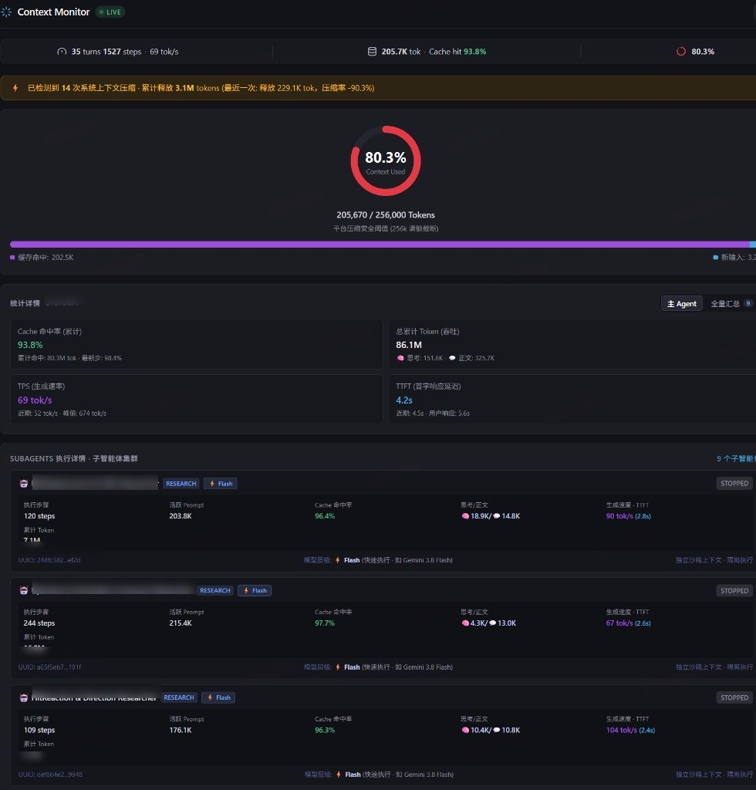
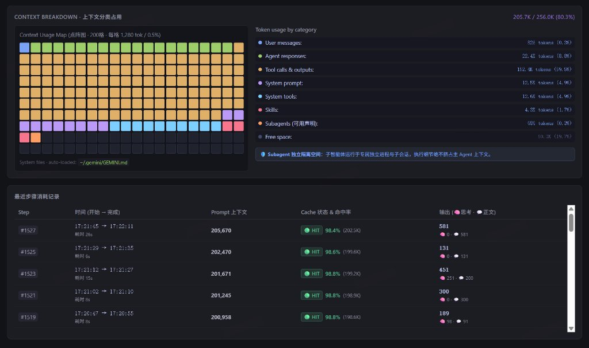

# Context Monitor for Google Antigravity

<p align="center">
  
</p>

<p align="center">
  <strong>专为 Google Antigravity (AGY) 打造的深度上下文与 Token 实时监控插件</strong><br>
  告别“黑盒”上下文，实时掌握 Token 消耗、Prompt Cache 命中率、Subagents 上下文隔离与推理性能指标。
</p>

<p align="center">
  
  
  
  
</p>

---

## 📸 效果预览 (Screenshots)

### 1. 实时概览看板 · 环形仪表盘 & Subagent 子智能体集群
> 实时统计状态条、环形水位表盘、Cache 命中分布、Token 吞吐速度 (TPS)、首字延迟 (TTFT) 以及多智能体独立沙盒上下文追踪：



### 2. 上下文分类点阵图 (Context Matrix Map) & 步骤消耗记录
> 200 格上下文细分矩阵（每格 0.5%）、八大类别 Token 占用明细与历史每一步的上下文增量及 Cache 状态：



---

## ✨ 核心特性

- 📊 **侧边栏实时可视化看板 (Sidecar Auxiliary Pane)**:
  - **环形水位表盘 (Donut Gauge)**：直观展示已用 Token / 安全压缩容量，自动识别当前模型并匹配平台压缩阈值（Gemini Carbon / Argon / Flash 256K、Claude Opus / Sonnet 512K，灰度突破时自动阶梯扩容）。
  - **200 格点阵图 (Context Usage Matrix Map)**：精细化映射上下文构成，哪些是工具输出、哪些是历史对话、哪些是系统提示词一目了然。
  - **Token 分类深度剖析**：精确区分 `User messages`、`Agent responses`、`Tool calls & outputs`、`System prompt`、`System tools`、`Skills`、`Subagents 声明` 与 `Free space`。
  - **性能实时指标**：实时计算推理 TPS (tok/s)、首字响应延迟 (TTFT)、Prompt Cache 累计与最新单步命中率。
  - **Subagents 隔离与生命周期追踪**：独立展示每个 Subagent 的沙盒上下文与模型层级，基于时序状态机精准识别 `等待后台任务`（如编译/测试）、`上下文压缩中`、`模型推理中` 等细分运行态。
  - **Step 消耗时序日志**：清晰追溯过去每一步的 Prompt 增量与 Cache Hit 状态。

- 🔄 **全链路免重启热重载 (Live Hot-Reload)**:
  - 修改 `core/*` 逻辑、`public/*` 前端界面或点击面板右上角 `↻` 按钮均可实时热更新生效，开发调试无需反复重启 Antigravity。

- ⚡ **即时技能查询 (`/context`)**:
  - 在对话中直接输入 `/context` 或询问“用了多少上下文”，智能 Agent 即可调取脚本输出即时状态摘要并提供侧边栏直达链接。

- 🛡️ **智能上下文健康守卫 (`rules/AGENTS.md`)**:
  - 持续关注长对话的上下文健康度。当接近警戒水位或步骤过多时，适时提示用户使用 `/compact` 压缩整理，保障推理响应速度与回答质量。

- 🪶 **轻量零依赖、开箱即用**:
  - 采用纯原生 Node.js 构建，无需任何第三方 npm 依赖包，启动迅速、安全轻便。

---

## 🚀 安装指引 (Installation)

### 方式一：通过 Antigravity CLI 一键安装（推荐）

1. 克隆本仓库到本地：
   ```bash
   git clone https://github.com/SeleneXX/antigravity-context-monitor.git
   ```

2. 使用 `agy` 命令行安装插件：
   ```bash
   agy plugin install ./antigravity-context-monitor
   ```
   > Antigravity 会自动校验插件配置并将其安装至用户的全局插件目录。

3. **重启 Antigravity** 即可生效！

---

### 方式二：团队项目级共享（无需成员手动安装）

如果希望在特定工程团队内共享，可直接利用 Antigravity 的项目级插件机制：

1. 在团队代码仓库的根目录下创建 `.agents/plugins/` 目录。
2. 将本仓库内容克隆或放置到 `.agents/plugins/context-monitor/`：
   ```bash
   git clone https://github.com/SeleneXX/antigravity-context-monitor.git .agents/plugins/context-monitor
   ```
3. 随项目代码一并提交至 Git。任何团队成员使用 Antigravity 打开该项目时，插件将**自动激活**。

---

### 方式三：手动放置安装

直接将本文件夹复制到 Antigravity 全局插件配置目录：
- **Windows**: `%USERPROFILE%\.gemini\config\plugins\context-monitor`
- **macOS / Linux**: `~/.gemini/config/plugins/context-monitor`

安装后重启 Antigravity 即可。

---

## 💡 使用方法

### 1. 聊天指令
在 Antigravity 聊天窗口中输入 `/context`，或直接向 Agent 提问：
- *"当前会话消耗了多少上下文？"*
- *"查看当前的 Cache 命中率和 Token 使用量"*

Agent 会即时返回如下格式的统计卡片：
```markdown
⏱️ 35 turns · 1527 steps | 💾 205.7K tok · Cache hit 93.8% | 🟢 80.3% (205,670 / 256k)
⚡ 当前模型: Gemini 3.8 Flash (High) | ⚡ TPS: 69 tok/s · TTFT: 4.2s | 🧠 思考: 151.6K · 💬 正文: 325.7K

[📊 打开侧边栏实时监控面板](sidecar://context-monitor/monitor/)
```

### 2. 侧边栏监控面板
点击聊天中的 `[Context Monitor](sidecar://context-monitor/monitor/)` 链接，即可在右侧 **Auxiliary Pane (辅助面板)** 打开常驻的实时仪表盘，数据每 1.5 秒自动同步。

---

## 📂 插件目录结构

```text
context-monitor/
├── plugin.json                 # 插件描述清单与元数据
├── README.md                   # 详细使用指南
├── assets/
│   ├── logo.svg                # 插件矢量图标
│   ├── preview-overview.jpg    # 仪表盘总览截图
│   └── preview-breakdown.jpg   # 上下文细分截图
├── core/                       # 统一共享解析引擎（Sidecar 与 CLI 共用）
│   ├── constants.mjs           # 模型压缩阈值、价格表与系统开销常量
│   ├── models.mjs              # 会话模型探测与子智能体层级映射
│   ├── transcript.mjs          # 单遍高性能日志解析与 mtime 内存缓存
│   ├── subagents.mjs           # 子智能体发现与时序状态机（含后台任务等待追踪）
│   └── analyzer.mjs            # 会话监控快照统一聚合出口
├── rules/
│   └── AGENTS.md               # 上下文健康感知与智能提示规则
├── skills/
│   └── context/
│       ├── SKILL.md            # /context 技能定义
│       └── scripts/
│           └── get_context.mjs # 实时统计提取脚本 (Node.js ESM)
└── sidecars/
    └── monitor/
        ├── sidecar.json        # 侧边栏扩展配置定义
        ├── hot-loader.mjs      # ESM 模块零停机热重载钩子
        ├── server.mjs          # 本地轻量 Web & 数据服务
        └── public/
            ├── index.html      # 仪表盘 HTML 骨架
            ├── styles.css      # 仪表盘样式系统
            └── app.js          # 前端渲染与热更新同步逻辑
```

---

## 📄 开源许可证

本项目基于 [MIT License](LICENSE) 开源。欢迎提交 Issue 与 Pull Request 共同改进！
